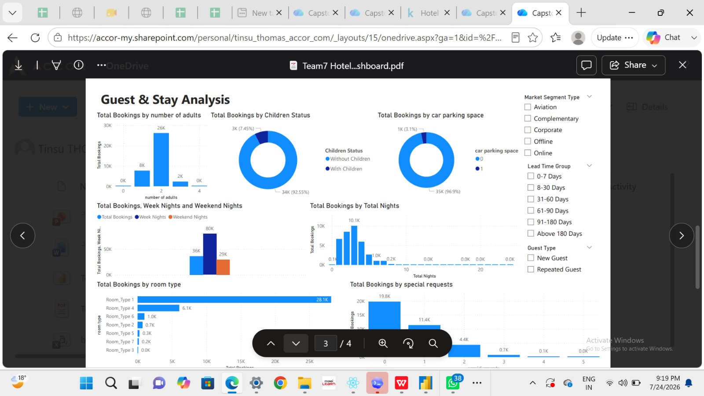
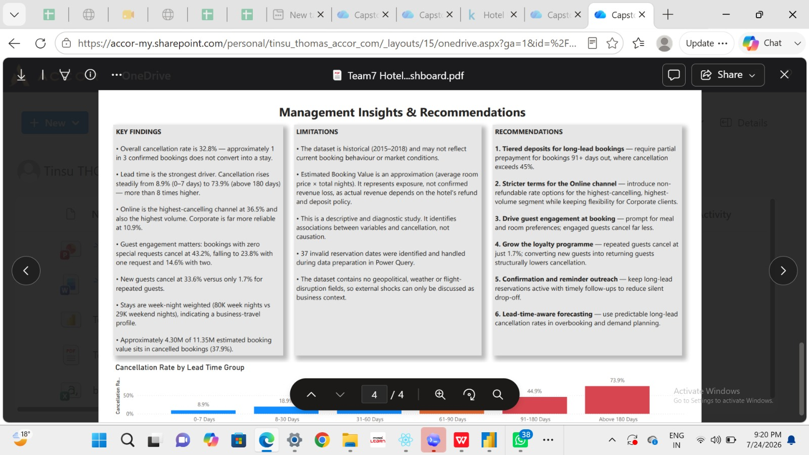

# 🏨 Hotel Booking Cancellation Analysis

### Business Analytics | Power BI | Data Analysis

An end-to-end business analytics project focused on analysing hotel booking cancellations, identifying cancellation patterns, and developing data-driven recommendations to support better hotel booking management.

---

## 📌 Project Overview

Hotel booking cancellations can affect room availability, occupancy planning, and revenue management.

The objective of this project was to analyse historical hotel booking data, identify important cancellation patterns, and present actionable insights through an interactive Power BI dashboard.

This project was completed by tawseef 

## 🎯 Business Problem

Hotels face challenges when customers cancel reservations, particularly when bookings are made well in advance.

This project explores:

- What percentage of hotel bookings are cancelled?
- How does booking lead time relate to cancellation rates?
- Which booking and customer patterns are associated with cancellations?
- What actions can hotel management consider to manage cancellation risk?

---

## 📊 Dataset Overview

| Description | Details |
|---|---|
| Total Records | 36,285 bookings |
| Total Variables | 17 |
| Data Period | October 2015 – December 2018 |
| Target Variable | IsCanceled |
| Analysis Type | Descriptive and Diagnostic |

---

## 🛠️ Tools & Technologies

- Microsoft Excel
- Power BI
- Power Query
- DAX
- Data Cleaning
- Data Transformation
- Exploratory Data Analysis (EDA)
- Business Analytics

---

## 🔄 Project Workflow

1. **Business Understanding** – Defined the business problem and project objectives.
2. **Data Understanding** – Examined the dataset, variables, and booking information.
3. **Data Cleaning** – Processed dates and prepared the dataset using Power Query.
4. **Data Transformation** – Created calculated columns and DAX measures.
5. **Exploratory Analysis** – Identified booking and cancellation patterns.
6. **Dashboard Development** – Built a four-page interactive Power BI dashboard.
7. **Business Recommendations** – Developed recommendations based on analytical findings.

---

## 🔍 Key Findings

### 1. Overall Cancellation Performance

| Metric | Result |
|---|---:|
| Total Bookings | 36,285 |
| Cancelled Bookings | 11,889 |
| Non-Cancelled Bookings | 24,396 |
| Overall Cancellation Rate | 32.8% |

### 2. Booking Lead Time Analysis

The analysis identified a strong relationship between booking lead time and cancellation rates.

| Booking Lead Time | Cancellation Rate |
|---|---:|
| 0–7 days | 8.9% |
| 8–30 days | 18.9% |
| 31–60 days | 23.5% |
| 61–90 days | 27.8% |
| 91–180 days | 44.9% |
| Above 180 days | 73.9% |

**Key Insight:** Bookings made more than 180 days before arrival had a substantially higher cancellation rate than bookings made within seven days of arrival.

*Note: These findings show an association, not proof that longer booking lead time causes cancellations.*

---

## 📈 Power BI Dashboard
## 📈 Dashboard Screenshots

### 1. Executive Overview
.jpg)

### 2. Cancellation Drivers

### 3. Guest and Stay Analysis
.jpg)

### 4. Management Insights

---

## 💡 Business Recommendations

Based on the analysis, the following recommendations were proposed:

- Consider tiered deposit policies for bookings with longer lead times.
- Send timely booking reminders to customers.
- Prioritise customer outreach for bookings with higher cancellation patterns.
- Use booking lead-time patterns when planning room availability.
- Monitor cancellation trends regularly to support better booking management.

---

## ⚠️ Project Limitations

- The dataset covers historical bookings from October 2015 to December 2018.
- The analysis is descriptive and diagnostic, not predictive.
- Observed relationships do not establish causation.
- Estimated booking value should not be interpreted as actual revenue or confirmed financial loss.
- The recommendations have not been tested through implementation.

---

## 📚 Key Learnings

Through this project, I developed practical experience in:

- Data cleaning and transformation using Power Query.
- Creating calculated columns and DAX measures.
- Analysing business data and identifying patterns.
- Building interactive Power BI dashboards.
- Presenting analytical findings.
- Converting data insights into business recommendations.
- ## SQL Analysis

Analysed 36,285 hotel bookings using SQL (SQLite) to understand what drives cancellations. Queries are in `hotel_queries.sql`.

**Key finding:** Bookings made 90+ days in advance had a 56.4% cancellation rate, compared with 25.1% for 30-90 days and 14.1% for under 30 days.

**Recommendation:** Introduce stricter deposit or cancellation policies for early bookings to reduce revenue loss.

**Tools:** SQL, SQLite

---

## 👨‍💻 Author

**Tawseef Ahmad Ganaie**

Aspiring Data Analyst | Business Analytics | Power BI

[GitHub Profile](https://github.com/tawseefah)

---

**Project Type:** capstone Project – EDGE Programme

*This project was completed by me. The analysis and findings are based on the project dataset and dashboard.*
